# Palm Mind RAG Backend

I built a FastAPI backend with two REST APIs.

The first one is a document ingestion API. You upload a PDF, TXT or DOCX file, pick a chunking strategy (recursive or semantic), and the app extracts the text, cleans it, splits it into chunks, turns the chunks into embeddings, and stores them in Qdrant. The document's details are saved in PostgreSQL.

The second one is a conversational RAG API. You chat with it and it answers questions from your uploaded documents, using search I wrote by hand (dense search plus BM25, merged with RRF and reranked). It remembers the conversation in Redis, so follow-up questions work. The same chat endpoint can also book an interview: it collects your name, email, date and time from normal messages, checks them, and saves the booking in PostgreSQL.

A small router decides what each message is about, so the app only searches your documents when it needs to.

Besides the two main endpoints, there are two small extras: you can list and delete uploaded documents, and you can limit a chat to chosen documents.

---

## Folder structure

```
palm-mind-rag/
├── app/
│   ├── main.py             # starts the app, loads models and connections once
│   ├── config.py           # settings from .env
│   ├── dependencies.py     # shared resources and the optional API key check
│   ├── errors.py           # which failures become 502 or 503
│   ├── schemas.py          # request and response types
│   ├── typedefs.py         # typed dicts for chunks and chat messages
│   ├── db.py               # PostgreSQL tables and save functions
│   ├── routes/
│   │   ├── ingestion.py    # upload, list and delete documents
│   │   └── chat.py         # POST /chat
│   └── services/
│       ├── embedder.py
│       ├── vector_store.py # Qdrant
│       ├── memory.py       # Redis
│       ├── llm.py          # Groq
│       ├── extraction.py   # PDF, TXT, DOCX (OCR optional)
│       ├── cleaning.py
│       ├── chunking.py     # recursive and semantic
│       ├── ingestion.py    # the full upload flow
│       ├── documents.py    # list and delete documents
│       ├── retrieval.py    # dense search, BM25, RRF
│       ├── reranking.py    # reranker and relevance cut-off
│       ├── generation.py   # question rewriting, prompt, answer
│       ├── rag.py          # RAG steps in order
│       ├── router.py       # detects intent, picks the workflow
│       └── booking.py      # kept separate from RAG
├── alembic/                # database migrations (they create the tables)
├── tests/
│    ├── __init__.py   
│    ├── conftest.py    
│    ├── testbooking.py  
│    ├── test_chat_Api.py          
│    ├── test_chunking.py       
│    ├── reranking.py   
│    ├── test_ingestion_api.py   
│    ├── test_retrieval.py          
│    └── test_documents_api.py  
             
├── docker-compose.yml      # Qdrant, Redis, PostgreSQL
├── alembic.ini
├── pyproject.toml          # pytest and mypy settings
├── requirements.txt
├── requirements-dev.txt    # extra packages for tests
├── .env.example
└── README.md
```

Original uploaded files are saved in `storage/uploads/`, which is created automatically when the app starts and is not committed to Git.

---

## System design

**Document ingestion**

1. Upload a file and choose `recursive` or `semantic` chunking.
2. Check the file (type, size, not empty) and save the original to disk.
3. Extract the text. PDFs are read page by page so page numbers are kept.
4. Clean the text (broken characters, extra spaces).
5. Split it into chunks with the chosen strategy.
6. Turn each chunk into an embedding.
7. Store the vectors, chunk text and details in Qdrant.
8. Save the document's details in PostgreSQL.
9. Add the new chunks to the in-memory BM25 keyword index (it is rebuilt from Qdrant when the app starts) and return the document ID.

If any step fails, the saved file and the stored chunks for that upload are removed.

Recursive chunking splits at paragraphs, then lines, then sentences. Semantic chunking compares each sentence with the next and starts a new chunk when the topic changes.

**Chat (including booking)**

1. Receive the message and session ID (a new session is made if none is sent; an unknown session ID is rejected with a 404).
2. Load the last few messages and any unfinished booking from Redis.
3. The router picks one intent: document question, follow-up, interview booking, booking follow-up, or general chat.
4. For a document question: rewrite follow-ups into full questions, search with dense search and BM25, merge with RRF, rerank, keep chunks above the cut-off, and let Groq answer from them. If nothing is relevant enough, it says so. The one exception is when you limit the chat to specific documents with `document_ids`: then the best chunks are used even if their scores are low.
5. For booking: Groq pulls out name, email, date and time, the app validates them (dates and times are checked in the configured timezone), asks for anything missing, then saves the finished booking in PostgreSQL. Unfinished bookings wait in a Redis Hash. Each date and time can only be booked once, so if the slot is taken the app asks for a different time.
6. For general chat: Groq replies, with no document search.
7. Save the messages and sources in Redis, and return the reply.

---

## Tech stack

- FastAPI: it is async, typed, and builds a test page for free, while Flask needs add-ons for all of that and Django is far too heavy for two endpoints.
- PyMuPDF and python-docx: PyMuPDF reads PDFs fast and page by page, which older libraries like PyPDF2 often do worse, and python-docx covers Word files.
- ftfy: PDFs produce broken characters, and a plain regex cannot repair those.
- Sentence Transformers (BAAI/bge-base-en-v1.5): strong quality that runs on a normal laptop, unlike paid embedding APIs that cost money and need the internet on every call.
- Qdrant: it runs with one Docker command and stores text and details next to each vector, while FAISS is only an index library with no storage or filtering.
- BM25 (rank_bm25): it finds exact names and terms, which vector search alone often misses.
- RRF: it merges two ranked lists without tuning, unlike mixing raw scores, which breaks because the two searches score on different scales.
- Reranker (BAAI/bge-reranker-base): it reads the question and chunk together, so it is far more accurate than trusting vector similarity alone.
- Groq: very fast replies, which matters because one chat message can use the LLM several times (route, rewrite, answer), and a slower host would feel sluggish.
- PostgreSQL, SQLAlchemy and Alembic: bookings and document records have a fixed shape, so SQL fits better than a document database, SQLite struggles when several users write at once, and Alembic creates the tables the same way on every machine.
- Redis: it has built-in expiry plus Lists and Hashes that match chat history and unfinished bookings, while an in-memory dictionary loses everything on restart.
- Docker Compose: one command starts all three databases, instead of installing each by hand.

---

## How to run it

You need: Python 3.11 or newer, Docker Desktop (running), Git, and a Groq API key with a model name from your Groq account.

1. Get the code:
```
git clone <your-repo-url>
cd palm-mind-rag
```

2. Create and activate a virtual environment.

Windows:
```
python -m venv .venv
.venv\Scripts\Activate.ps1
```
Mac or Linux:
```
python3 -m venv .venv
source .venv/bin/activate
```

3. Install the packages (this takes a few minutes):
```
pip install torch --index-url https://download.pytorch.org/whl/cpu
pip install -r requirements.txt
```

4. Make your settings file, then open `.env` and fill in `GROQ_API_KEY` and `GROQ_MODEL` (no quotes, no spaces around the `=`). Also set `TIMEZONE`, for example `Asia/Kathmandu`, so "today" and "tomorrow" in bookings match your clock.

Windows: `Copy-Item .env.example .env`
Mac or Linux: `cp .env.example .env`

5. Start the databases and create the tables:
```
docker compose up -d
alembic upgrade head
```

6. Start the app. The first start is slow because the models download:
```
uvicorn app.main:app
```

7. Open http://localhost:8000/docs. You can test everything from this page by clicking buttons:
   - `POST /documents/upload`: choose a file and a `chunking_strategy`.
   - `GET /documents`: list what you uploaded. Copy a `document_id` if you want a chat to search only that file.
   - `DELETE /documents/{document_id}`: remove a document, its chunks and its file.
   - `POST /chat`: send `{"message": "your question"}`. The reply includes a `session_id`. Paste it into your next message to keep the same conversation, or leave it out to start a new one. To search only some files, add `"document_ids": ["<id>"]`.
   - To book an interview, send "I want to book an interview" and then give your details, using the same `session_id`.

If you set `API_KEY` in `.env`, every request must send it in an `X-API-Key` header. Leave it empty to turn the check off (the default).

**Run the tests**

```
pip install -r requirements-dev.txt
python -m pytest
```
The dev file also lists EasyOCR, which is large and only needed for OCR. To skip it, install just `pytest pytest-asyncio httpx aiosqlite`.


---

## Settings

Everything is in `.env`, and the app needs a restart after any change. The ones you might care about:

- `MAX_UPLOAD_MB`: largest file allowed (10).
- `ENABLE_OCR`: reads scanned PDF pages, off by default. It needs EasyOCR from the dev packages.
- Chunk sizes: `RECURSIVE_CHUNK_SIZE` (1000) and `SEMANTIC_MAX_CHARS` (1000).
- `RELEVANCE_THRESHOLD`: how high a chunk must score to be used (0.2 by default, and `.env.example` sets 0.3). Lower it if good questions get "not found".
- `FINAL_TOP_K`: how many chunks go into the answer (5).
- `CHAT_TTL_SECONDS` and `BOOKING_TTL_SECONDS`: how long chats (24 hours) and unfinished bookings (1 hour) are kept.
- `TIMEZONE`: the timezone used to check booking dates and times (UTC by default).
- `API_KEY`: turns on the `X-API-Key` check (empty by default, so it is off).

---

## Known limits

- All uploaded documents are shared by every chat session. Use `document_ids` to limit a chat to chosen files.
- The BM25 index lives in the app's memory, so run one worker (the default). Uploads would not show up in other workers.
- DOCX tables are not read yet, and TXT files must be UTF-8.
- Large files in semantic mode can take a long time, because every sentence is embedded.

---

## Evidence

**Document ingestion**
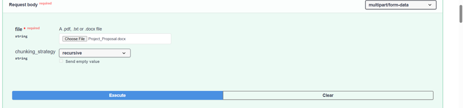
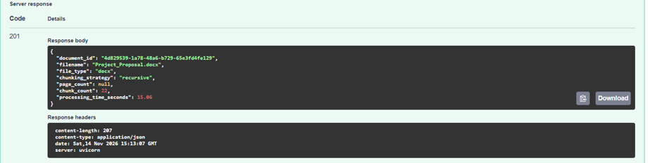
>  Caption: Uploading a document with `recursive` chunking and the 201 response showing the chunk count.
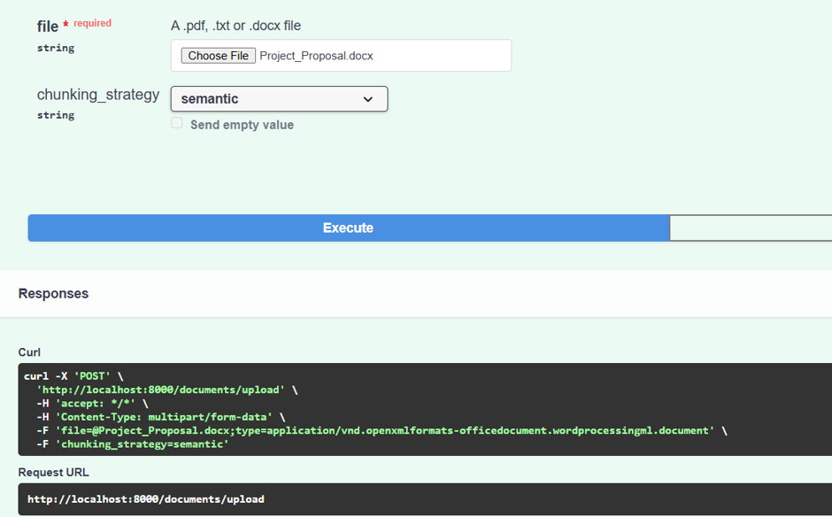
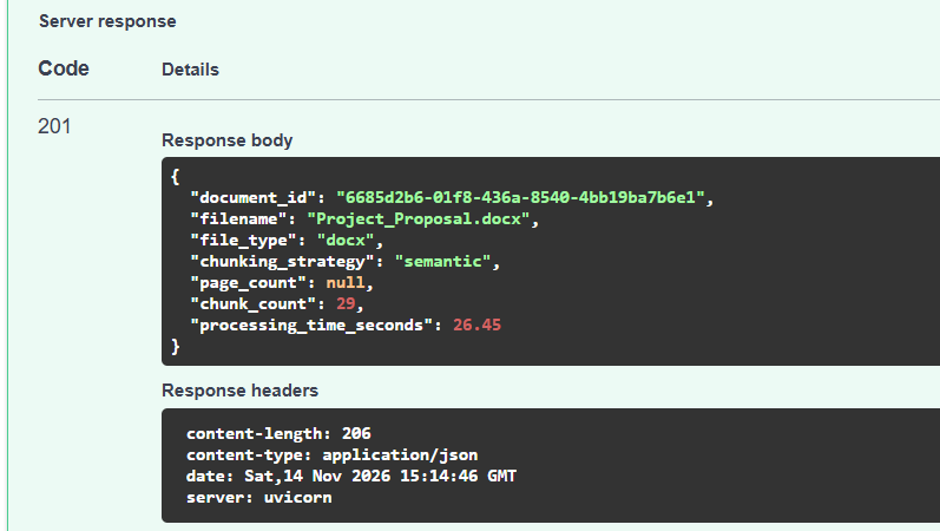
>  Caption: Uploading a document with `semantic` chunking and the 201 response showing the chunk count.

**Chat**
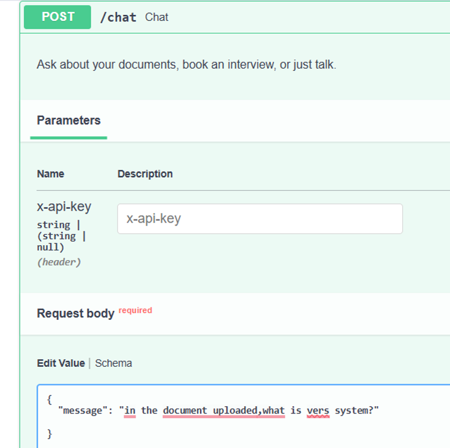
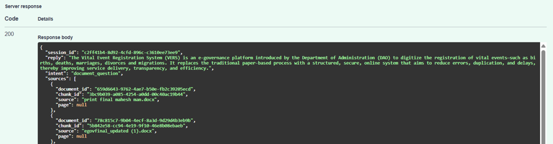
>  Caption: A sample question answered from the document, with its source references.
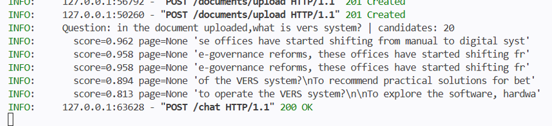
> Caption: The uvicorn terminal log showing the reranker scores for that question, with the best chunk above the relevance cut-off.

**Interview booking**
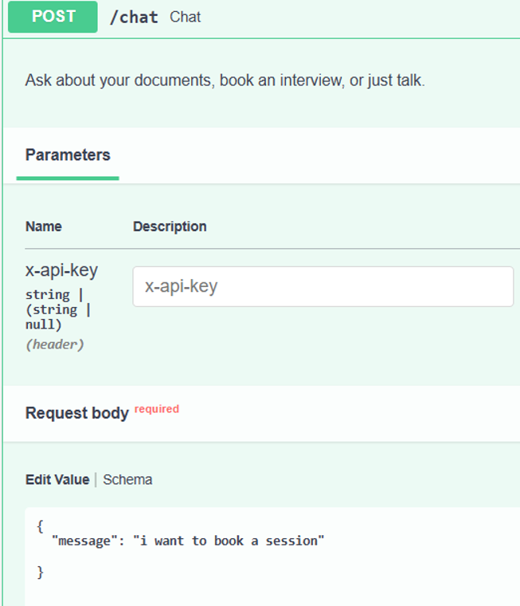
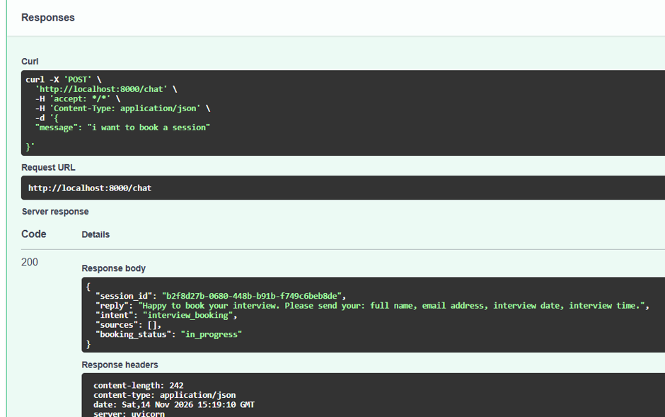

booking follow-up:

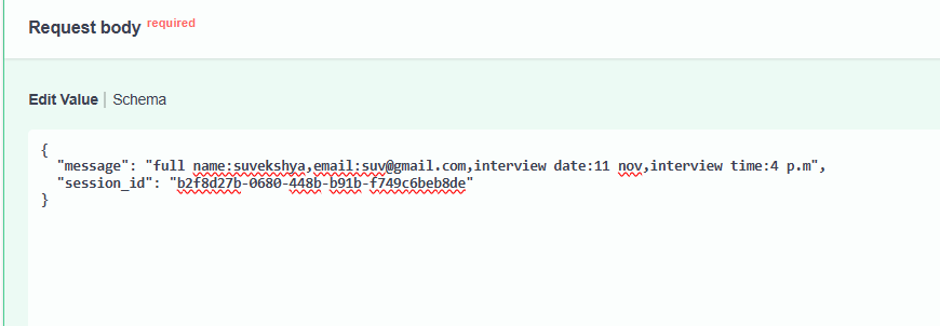
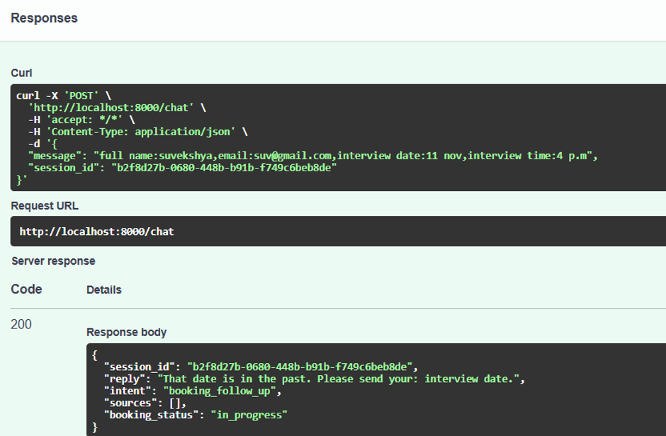

booking reservation done:
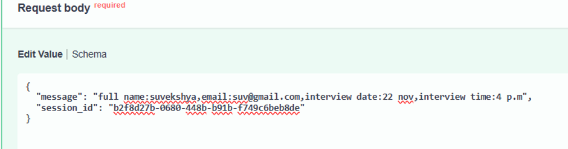
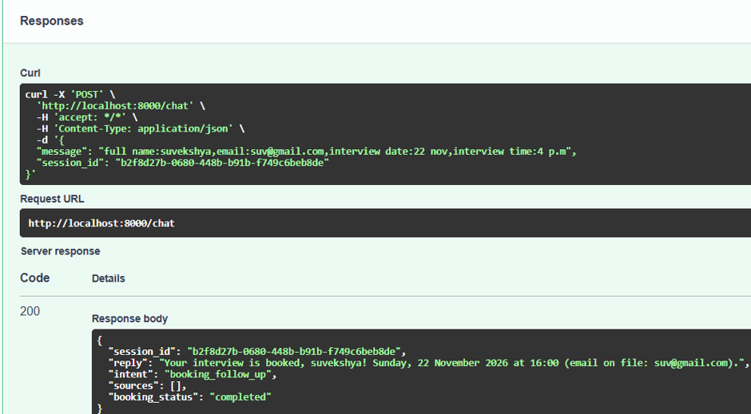
>  Caption: A booking completed over several messages, ending with `booking_status: completed`.
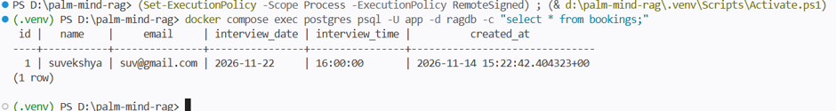
> Caption: The saved booking in the PostgreSQL `bookings` table.

**Automated tests**

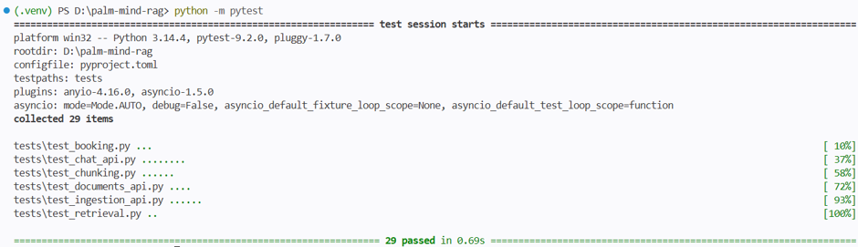
>  Caption: Output of `python -m pytest` with all tests passing.